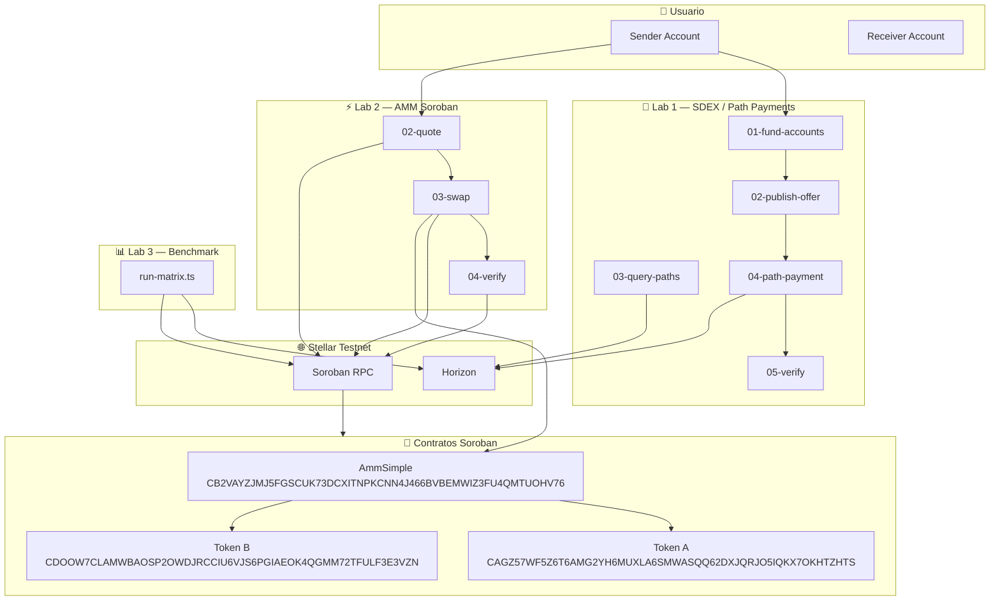

# Arquitectura del Sistema — LabSWAP

> Documento de arquitectura técnica para los laboratorios de swap en Stellar.

## 1. Visión General

| Motor | Nivel | Lógica de precio | Contratos | Labs |
|-------|-------|------------------|-----------|------|
| SDEX | Protocolo | Cruce de libro de órdenes | No (nativo) | Lab 1, Lab 3 |
| AMM Soroban | Contrato inteligente | x*y=k | Sí | Lab 2, Lab 3 |

## 2. Diagrama de Arquitectura

## 3. Contratos Desplegados en Testnet

| Contrato | ID | Funciones |
|----------|-----|-----------|
| AMM Simple | `CB2VAYZJMJ5FGSCUK73DCXITNPKCNN4J466BVBEMWIZ3FU4QMTUOHV76` | initialize, swap, swap_exact_out, get_reserves, get_price |
| Token A | `CAGZ57WF5Z6T6AMG2YH6MUXLA6SMWASQQ62DXJQRJO5IQKX7OKHTZHTS` | initialize, mint, transfer, balance |
| Token B | `CDOOW7CLAMWBAOSP2OWDJRCCIU6VJS6PGIAEOK4QGMM72TFULF3E3VZN` | initialize, mint, transfer, balance |

## 4. Variables de Entorno

Copiar `.env.example` a `.env` y rellenar con valores reales. Nunca commitear `.env`.

## 5. Seguridad

- `.env` y `logs/` están en `.gitignore`
- Nunca commitear secretos (`S...`)
- Verificar: `grep -r "S[A-Z][A-Z0-9]{40,}" --exclude-dir=node_modules .`

## 6. Referencias

- Stellar Path Payments: https://developers.stellar.org/docs/build/guides/transactions/path-payments
- Soroswap AMM: https://docs.soroswap.finance/amm/how-it-works
- Soroban: https://developers.stellar.org/docs/build/smart-contracts
